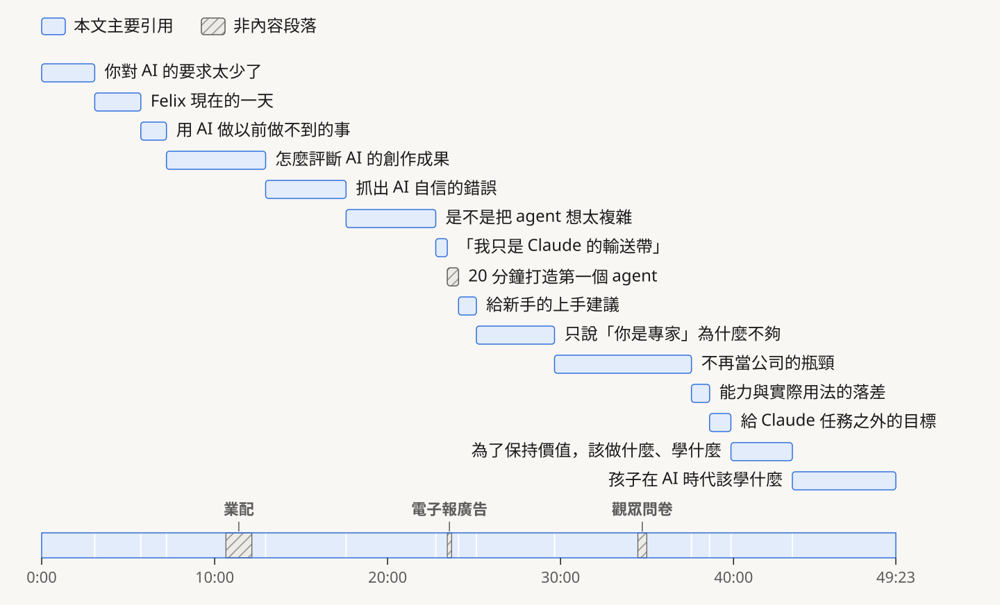
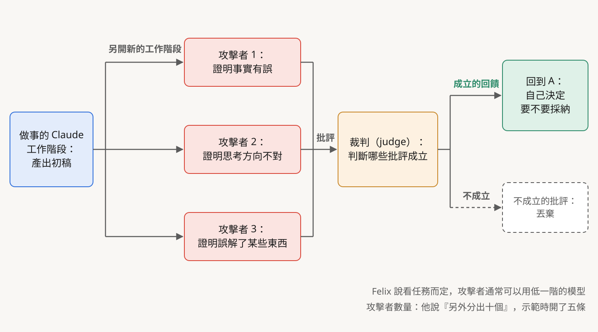
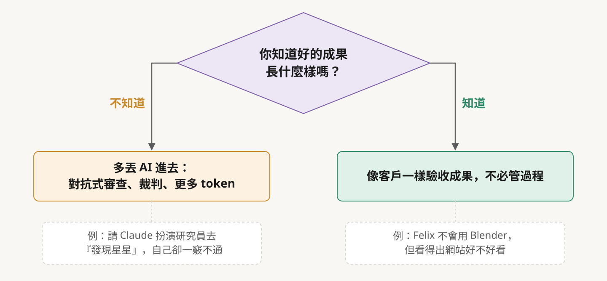
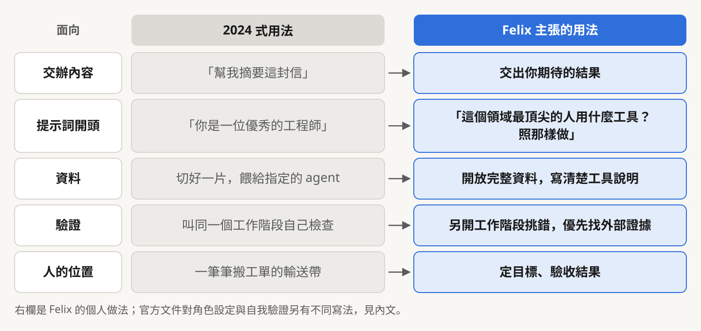
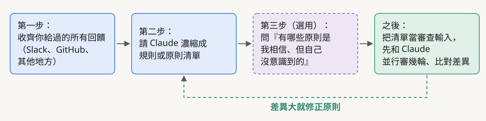
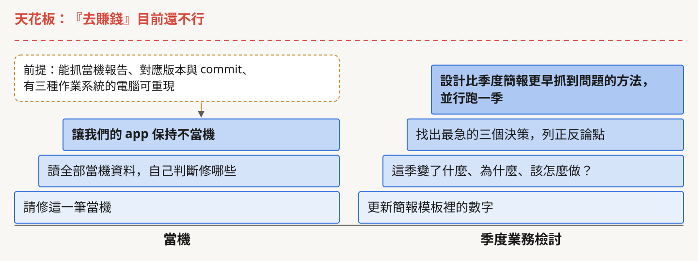
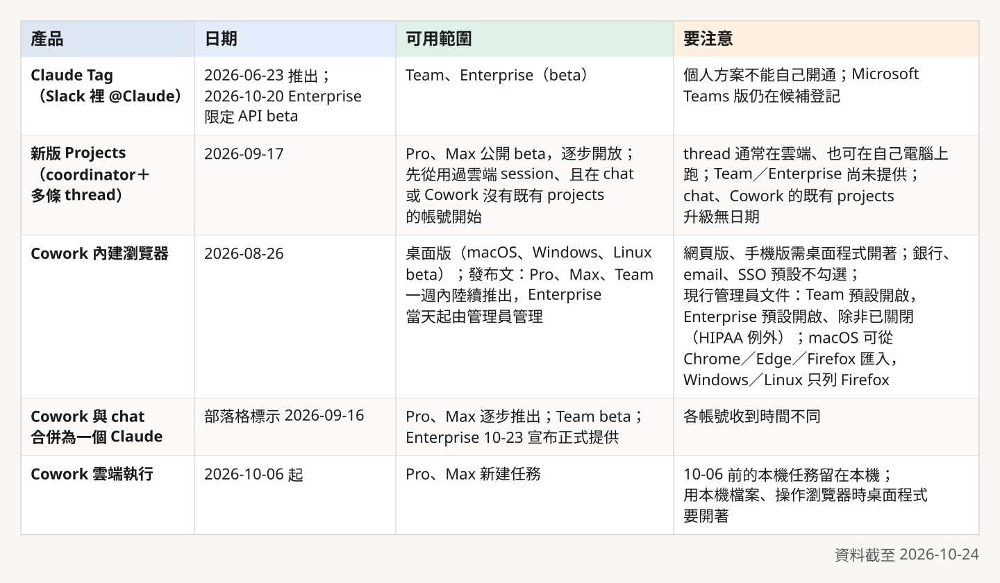

# 別再當 Claude 的輸送帶：Felix Rieseberg 談 2024 年之後的用法

*封面插圖為本文以概念比喻繪製：左邊是把當機紀錄一筆筆搬給 Claude 的『輸送帶』，右邊是把整個目標交出去。*

> 本導讀的分析與撰稿由 AI 模型完成，不是人類分析，也沒有經過人工逐句校稿。翻譯、查證、審稿與插圖同樣由 AI 模型分工完成，各模型的分工見文末〈製作說明〉；完整繁中譯文見[譯文頁](translation-zh.html)。文中重要說法都附來源連結，請以來源為準。

## 一筆當機紀錄，從人手上搬到 Claude 面前

大約一年半前，Felix Rieseberg 的工作裡有一段很像工廠產線：打開當機紀錄，挑一筆，搬到 Claude 面前，說「請修這個」，修完再去挑下一筆。在 Silicon Valley Girl 頻道 2026 年 10 月 20 日上架的訪談裡，他這樣形容當時的自己：「我只是 Claude 的輸送帶。」（[22:48](https://www.youtube.com/watch?v=D-SVFneJ_Nk&t=1368s)）

後來他換了做法，讓 Claude 能存取全部的當機資料，自己判斷哪些該修、哪些不用修。他在 10 月 13 日的文章裡寫得更具體：去年年初還在請 Claude 修個別的當機，後來直接請它讓「我們的 app 保持不當機」；為了做到這點，他先得讓 Claude 能抓當機報告、知道哪個 app 版本對應哪個 git commit，還要給它 Windows、macOS、Linux 電腦，讓它能自己重現問題、驗證修正（[Felix Rieseberg，2026-10-13](https://felixrieseberg.com/how-to-be-more-ambitious-a-tutorial-for-humans-with-models/)）。這段是他的自述，外人無從查核，但它把整場訪談的主題說得很清楚：人交給模型的，常常是一張張小工單，模型其實已經可以接下整個目標。

Felix 在個人網站自述，他在 Anthropic 領導過 Claude.ai、Cowork 與 Code Desktop 的工程（[About me](https://felixrieseberg.com/about-me/)）；影片旁白說他「負責 Claude 的工程」，範圍比他自己寫的寬。

這場 49 分鐘的對談，主持人是這個頻道的經營者，帶著一個 35 人的團隊，這個頻道的所有營運都用 Claude（[01:00](https://www.youtube.com/watch?v=D-SVFneJ_Nk&t=60s)）。她一路追問的問題，很多讀者大概也想問：還能交出去更多嗎？交出去之後，要怎麼知道它沒有一本正經地出錯？

*圖：訪談 15 個章節的時間軸。章節名依影片說明欄翻譯；灰色色塊為業配、電子報廣告與問卷，本文未納入。資料來源：YouTube 影片說明欄。*

## 先看重點

| 主題 | Felix 的說法 | 對照結果 |
|---|---|---|
| 要求太少 | 只拿 AI 問「法國首都是哪裡」、改信件語氣，等於沒用到新一代模型 | 個人主張，出自他 10/13 的文章 |
| 抓自信的錯誤 | 很少讓目前的工作階段評斷自己；另開工作階段做對抗式審查 | 與 Claude Code 官方最佳實務同方向；Anthropic 的 Opus 5 提示指南另有不同建議 |
| agent（代理）別想太複雜 | 不必先編一組角色，給完整資料和寫清楚的工具 | 與〈Building effective agents〉的「先求最簡單」一致；舉的數學奧賽例子時間記錯（可疑） |
| 「你是專家」不夠 | 角色設定容易變成角色扮演，要的是專業者的工具與方法 | 官方文件仍保留「給 Claude 一個角色」，但已說重手的角色設定往往不必要 |
| 不當瓶頸 | 讓 Claude 看完整資料、並行對照你的回饋，再交出去 | 做法是他的經驗；提到的 Claude Tag、新版 Projects 都有方案限制 |
| 學習與下一代 | 作品集、同理心、懂公司怎麼運作 | 個人觀點 |

## 一、只拿它摘要信件，等於沒用到新的智慧

影片開頭剪了一句話當預告：「如果我們做的只是『幫我摘要這封信』，那你並沒有真正從新的智慧中得到好處。」這句話原本出現在 [39:35](https://www.youtube.com/watch?v=D-SVFneJ_Nk&t=2375s) 附近的段落，Felix 在 10 月 13 日的文章裡用了相近的例子，說很多人還在摸索新翅膀能幹嘛，只會問「法國首都是哪裡」或「能不能讓這封信聽起來沒那麼生氣」（[Felix Rieseberg](https://felixrieseberg.com/how-to-be-more-ambitious-a-tutorial-for-humans-with-models/)）。

他把 AI 的用途分成兩類。自動化，是把讓你沒辦法做喜歡的工作、或很花錢的事拿掉；他認為目前 AI 創造的經濟價值「大概大部分就來自這裡」（[06:05](https://www.youtube.com/watch?v=D-SVFneJ_Nk&t=365s)）。他覺得更有意思的是能力增強（augmentation）：AI 替你做你缺技能、缺技巧或缺知識而做不到的事。他去拜訪公司時，最讓他印象深刻的「往往不是那個工具本身能做什麼」，是人怎麼改了自己的工作流程（[06:36](https://www.youtube.com/watch?v=D-SVFneJ_Nk&t=396s)）。「大部分經濟價值來自自動化」是他加了「大概」的個人判斷，沒有附資料。

他自己的一天就是例子。主持人提到他已經不寫程式了，他沒有否認，接著說自己變成產品經理、工程經理、帶人的主管和資料科學家的「奇怪混合體」，一天裡花最多時間的是打原型：先想幾晚，再叫 Claude 把各種變體全部做出來，然後評析哪些是好點子（[03:00](https://www.youtube.com/watch?v=D-SVFneJ_Nk&t=180s)–[04:03](https://www.youtube.com/watch?v=D-SVFneJ_Nk&t=243s)）。

這裡有個容易被跳過的轉折。過去十幾年，工程經理決定要不要做一個東西，要先算做不做得出來、維護成本、機會成本；現在可以直接快轉到「先做一個原型給我玩」（[04:34](https://www.youtube.com/watch?v=D-SVFneJ_Nk&t=274s)）。成本降下來之後，卡住的變成人的注意力。他對主持人說：「我大概一天可以給你看一樣東西，但我可以輕鬆做出一千個。」（[05:04](https://www.youtube.com/watch?v=D-SVFneJ_Nk&t=304s)）一千個做得出來、一個看得完，後面幾章其實都在處理這個落差：判斷好壞的工作要怎麼分出去。

他舉的野心案例，是一位他認為「本行其實是產品經理」的人：對方把 Claude 指向大量 NASA 資料，請它幫忙找一顆新行星（[02:00](https://www.youtube.com/watch?v=D-SVFneJ_Nk&t=120s)）。他說「好像還沒被確認，NASA 正在著手確認」，也自承「講得有點沒把握」。

對照當事人公開的資料：獨立研究者 Pavel Rabtsevich 在 2026 年 9 月 25 日於 Zenodo 發表預印本，報告恆星 TIC 4206066 的凌日訊號，在 TESS 的 Sector 98 發現、回溯到 Sector 6 與 32，週期約 3.18 天；若真的繞著這顆星，半徑約為地球的 1.4 倍（[Zenodo](https://zenodo.org/doi/10.5281/zenodo.22967456)）。[Scientific American](https://www.scientificamerican.com/article/amateur-astronomer-harnesses-ai-to-find-a-possible-hidden-exoplanet/)（2026-10-14）報導這顆星距地球約 116 光年。他受訪時說，這項搜尋少不了 AI，他用了多個 agent，模型「寫程式、執行，再互相檢查彼此的工作」，但問題、計畫、規則和每個決定都是他自己的。TESS 的導演裁量目標名單列有他申請的 Program 100，以兩分鐘間隔觀測這顆星（[TESS DDT](https://tess.mit.edu/science/ddt/)）；官方 [Sector 110 兩分鐘目標清單](https://tess.mit.edu/public/target_lists/2m/all_targets_S110_v1.csv)收了這顆星，該 sector 的[觀測期](https://tess.mit.edu/observations/sector-110/)是 2026 年 10 月 31 日至 11 月 26 日。同一篇報導裡，一位 TESS 團隊成員說，這個訊號 2020 年曾被偵測濾波器抓到，因證據不足被排除；另一位天文學家的篩選軟體在 2026 年初也獨立選出過它。

截至 10 月 24 日它仍是候選，預印本也寫明沒有宣稱完成統計驗證。所以「Claude 找到新行星」說得太滿，「NASA 正在確認」也不準確。比較貼近事實的說法是：一位獨立研究者，用多個 AI agent 篩出一個值得望遠鏡再看一次的候選，而且他未必是第一個看到的人。他的流程裡有讓模型互相檢查的一步，但他也在同一篇報導裡說「模型彼此同意不算證據」，他靠的是任何人都能量測的訊號、任何人都能重跑的計算。這兩點正好對上 Felix 後面講的對抗式審查與外部證據。

## 二、什麼叫「好」：天氣預報的例子

主持人問了一個知識工作者都會卡住的問題：寫程式至少知道不要有 bug，文字和創意的成果要怎麼定義好壞？

Felix 用天氣回答（[07:37](https://www.youtube.com/watch?v=D-SVFneJ_Nk&t=457s)）。假設你請 agent 查外面幾度。模型隨便猜一個溫度，剛好猜對，他說「那不該算及格」；反過來，溫度差了半度，但找對地點、用了信譽良好的資料來源、整個過程站得住腳，應該比「猜中的好結果」更好。

這個立場和 Anthropic 自家的評測文章不完全同向。〈Demystifying evals for AI agents〉（2026-01-09）寫的是，agent 常會找到評測設計者沒想到的有效解法，為了不懲罰創意，「通常比較好的做法是評它產出了什麼，而不是它走的路徑」；但同一篇也建議在測試結果之外「也評估 transcript」，多步驟任務要給部分分數（[Anthropic](https://www.anthropic.com/engineering/demystifying-evals-for-ai-agents)）。兩邊的交集是：只看最後答案對不對，不夠。差別在於，Felix 把過程正確擺在結果之上，官方評測文章則以結果為主、過程為輔。照他的例子設計自己的檢查時，可以兩樣都看：答案對不對，也看它查了哪些來源、怎麼算出來的；兩者衝突時，先想清楚這件事你比較怕哪一種錯。

文字工作怎麼辦？他舉作家朋友 Adam Davidson 的提示詞：「把我的論點放大一百倍」「你最不同意的是哪些地方？最強的反方論點是什麼？」（[08:38](https://www.youtube.com/watch?v=D-SVFneJ_Nk&t=518s)）他從中得到的心得是，知識工作的秘訣比較少在「要一個好的產出」，多在中間那一步：這個領域最頂尖的人是怎麼工作的，能不能把那些步驟交給模型。他說跟厲害的作者、藝術家聊，他們多半不認為作品好是因為神來之筆，常說「這是努力的成果」（[09:09](https://www.youtube.com/watch?v=D-SVFneJ_Nk&t=549s)）。

他接著說，最近在動態、影片和 3D 上，公開可見的例子很多；他認為 Opus 5.5「在這方面有相當大的跳躍」，但大家真正做出的大跳躍，「其實就只是告訴 Claude 去用 Blender」（[10:09](https://www.youtube.com/watch?v=D-SVFneJ_Nk&t=609s)）。前半句要打折扣：Opus 5.5 的[官方發布頁](https://www.anthropic.com/claude-opus-5-5)（2026-09-22）沒有提到動態、影片或 3D 的進步。能對上的是兩件別的事：圖表辨識基準 Chartography（with tools）Opus 5.5 為 89.0%、Opus 5 為 83.4%；以及一位測試者讓幾個 Claude 模型用單一提示做遊戲，Opus 5.5 在畫面與完成度上得分最高。動態與影片的進步，屬於 Felix 的個人觀察（單方說法）。

後半句倒有他自己的書面紀錄。他說自己用一堆 3D 素材重做了個人網站，「完全不會用 Blender，從來沒用過」（[15:45](https://www.youtube.com/watch?v=D-SVFneJ_Nk&t=945s)）；他 9 月 27 日的文章記錄了這次改版，說大約 60 條 thread 經常平行工作，內容包括在 Blender 裡做一段 CGI 模仿紀錄片（[Made by mechanical means](https://felixrieseberg.com/made-by-mechanical-means/)）。這類只有本人說、外人無法查核的事，本文標為「當事方自揭」。

## 三、抓自信的錯誤：別讓同一個工作階段評自己

主持人換了個方向問：如果她請 Claude 扮演研究員去「發現星星」，自己卻對那個領域一無所知，要怎麼保護自己，不被 AI 信心滿滿端出來的錯誤騙到？（[12:40](https://www.youtube.com/watch?v=D-SVFneJ_Nk&t=760s)）

Felix 說他有一個「很實用、很簡單的答案」：對抗式審查（[12:40](https://www.youtube.com/watch?v=D-SVFneJ_Nk&t=760s)）。做法是一個 Claude 做完任務，再另外分出十個，唯一任務就是攻擊這個成果、證明它錯在哪裡，「跟紅隊演練或放空是同一個概念」（[13:12](https://www.youtube.com/watch?v=D-SVFneJ_Nk&t=792s)）。審查不一定要用同等級的模型，因為挑錯比創造容易，「通常你可以把智慧等級降一階，仍然能得到很好的結果」（[13:43](https://www.youtube.com/watch?v=D-SVFneJ_Nk&t=823s)）。這一點官方文件沒有對應的量化資料，是他的經驗判斷（單方說法）。

他示範的是當天早上寫的一篇部落格文章：在 Claude Projects 裡開五條對話串，分別去證明文章錯了、思考方向不對、事實有誤、誤解了某些東西（[14:15](https://www.youtube.com/watch?v=D-SVFneJ_Nk&t=855s)）。

批評回來一大堆，要聽誰的？主持人說她也會拿不同模型互審，卻常被意見淹沒。Felix 的答案「又是 Claude」：他們在寫程式時用一個「裁判」（judge），讀完所有攻擊者的批評，判斷哪些成立（[14:45](https://www.youtube.com/watch?v=D-SVFneJ_Nk&t=885s)）；成立的回饋送回原本做事的那個 Claude，由它自己決定要不要採納（[15:15](https://www.youtube.com/watch?v=D-SVFneJ_Nk&t=915s)）。如果回饋看來合理，卻漏掉重點或不太能照做，他說那「通常就是我知道自己的產出已經相當不錯的時候」。這套裁判流程是 Anthropic 團隊的內部做法，沒有公開文件可對照（當事方自揭）。

*圖：Felix 描述的對抗式審查流程，依訪談 12:40–15:45 整理。裁判流程是 Anthropic 團隊的內部做法，沒有公開文件。*

他也沒有把這套流程當成萬用解。他把情況分成兩個桶子：完全不知道好成果長什麼樣，就「更多 AI，直接丟更多 token 下去」；知道好的長什麼樣，像他判斷網站好不好看，那可能就夠了：你站在客戶的位置驗收成果，不必搞懂整個過程（[16:15](https://www.youtube.com/watch?v=D-SVFneJ_Nk&t=975s)）。

*圖：Felix 的『兩個桶子』，依訪談 15:45–16:45 整理。*

整場最關鍵的一句出現在後段。主持人問還有什麼不放心交給 agent，他說問題比較不是「不信任 Claude 做什麼」，比較是「不信任單一一個工作階段做什麼」；而後者的清單大得多。「我很少希望由目前的工作階段來評斷它自己，這點我覺得還是很靠不住。」（[26:19](https://www.youtube.com/watch?v=D-SVFneJ_Nk&t=1579s)）原文用的是 rarely，「很少」，不是「從不」。他優先找外部的硬證據，「不得已的時候」才用另一個 Claude 工作階段當外部訊號（[26:49](https://www.youtube.com/watch?v=D-SVFneJ_Nk&t=1609s)）。他的文章把這點寫成時間有限的建議：「不要叫模型評斷自己」，他預期模型更聰明之後會解決，但在 2026 年 10 月，他力勸讀者堅持外部驗證，最好是模型能自己執行、立刻得到回饋的工具（[Felix Rieseberg](https://felixrieseberg.com/how-to-be-more-ambitious-a-tutorial-for-humans-with-models/)）。

Anthropic 的官方文件在這件事上有兩種方向，不能簡化成「官方支持」。[Claude Code best practices](https://code.claude.com/docs/en/best-practices) 建議讓全新 context 的模型或 subagent 試著反駁結果、做對抗式審查，和 Felix 同口徑。[Prompting Claude Opus 5](https://platform.claude.com/docs/en/build-with-claude/prompt-engineering/prompting-claude-opus-5) 則說 Opus 5 不用提示就會自己驗證，建議移除額外的驗證指令，範例提示裡甚至寫「不要用 subagent 驗證或複查自己的工作」，理由是會增加成本與時間；同一頁也說 Opus 5 能有效執行 writer-verifier 模式。那句話是控制成本的範例提示，不是通則。兩份文件放在一起讀，比較合理的結論是：獨立審查有用，但要算成本，而且要看你用的是哪一代模型。

有一處反倒要小心。他說在事實查核上，只要請 Claude 替每個數字找一手來源，「拿到的輸出我百分之百完全信任」，而且只要一個 agent（[17:15](https://www.youtube.com/watch?v=D-SVFneJ_Nk&t=1035s)）。這和他自己「很少讓工作階段評斷自己」的原則有點張力，也沒有任何資料支撐（單方說法）。

## 四、我們是不是把 agent 想得太複雜

Felix 自己說這是「有點辣」的看法：「我覺得我們對 agent 這件事有點用力過頭了。」（[17:45](https://www.youtube.com/watch?v=D-SVFneJ_Nk&t=1065s)）他的論據是模型是很好的通才。他舉數學奧賽：Google DeepMind 用客製模型與客製 harness（執行框架）拿到銀牌，「四、五個月後」主要通用模型直接拿下金牌。

方向大致成立，時間記錯了（可疑）。DeepMind 的 AlphaProof 與 AlphaGeometry 2 拿到 IMO 銀牌水準，公告於 [2024 年 7 月 25 日](https://deepmind.google/discover/blog/ai-solves-imo-problems-at-silver-medal-level/)；金牌水準公告於 [2025 年 7 月 21 日](https://deepmind.google/discover/blog/advanced-version-of-gemini-with-deep-think-officially-achieves-gold-medal-standard-at-the-international-mathematical-olympiad/)，相隔約一年。

他真正想說的是後面這段：人類替 AI 戴一頂小帽子，像「你是資料科學家」，比較容易想像它能做什麼，但那個資料科學家的智慧，和頂尖生物學家、數學家是同一個。「我們有時候是在限制自己使用 AI 的方式：硬要先編出這一整個角色陣容。」（[18:16](https://www.youtube.com/watch?v=D-SVFneJ_Nk&t=1096s)）

資料也一樣。主持人問，是不是每個 agent 都該餵特定資料集？Felix 說他的做法相反：把資料切成一片一片分給各個 agent 並不對，因為人要把工作做好，也需要看到整個業務的全貌。他當工程經理，如果只拿到程式碼，能幫上的遠不如同時有客戶資料、客戶通話和業務資料（[18:46](https://www.youtube.com/watch?v=D-SVFneJ_Nk&t=1126s)、[19:16](https://www.youtube.com/watch?v=D-SVFneJ_Nk&t=1156s)）。資料太多怎麼辦？「靠工具。」給它們工具，把工具背後是什麼資料寫清楚，它們就不必把整包資料吞進去（[19:46](https://www.youtube.com/watch?v=D-SVFneJ_Nk&t=1186s)）。他的理由是模型在工具呼叫上進步很多，知道什麼時候該用、不會卡在一直呼叫同一個工具的迴圈裡（[20:46](https://www.youtube.com/watch?v=D-SVFneJ_Nk&t=1246s)）。

這段和 Anthropic 2024 年底的〈[Building effective agents](https://www.anthropic.com/engineering/building-effective-agents)〉高度一致：那篇寫「找出最簡單的解法，只在需要時才增加複雜度」，並把用工具文件與測試打磨 agent-computer interface（ACI）列為核心原則。不過官方也有另一面。2025 年的〈[How we built our multi-agent research system](https://www.anthropic.com/engineering/multi-agent-research-system)〉描述主 agent 指揮多個 subagent 平行研究，每個 subagent 要有目標、輸出格式、工具指引與明確的任務邊界。兩篇是不同情境下的建議，不互相衝突；Felix 反對的是先替模型編角色、切資料，不是反對分工本身。他自己的文章也這樣用：在「範圍」那一節，他建議想像一支團隊需要哪些專業（分析師、記者、編輯，甚至放空者與鑑識會計師），但提醒這只是用來找領域和技巧，「很容易不小心變成角色扮演」（[Felix Rieseberg](https://felixrieseberg.com/how-to-be-more-ambitious-a-tutorial-for-humans-with-models/)）。

主持人接著問他還用不用 skill。他說還是用了不少，但「Anthropic 官方的建議，還有我個人的建議，都是對 skill 要非常小心」，因為很多 skill 是在告訴模型只跟上一代相關的事，「一個好 skill 的半衰期很短」，有時把 skill 整個拿掉，輸出反而更好（[21:16](https://www.youtube.com/watch?v=D-SVFneJ_Nk&t=1276s)、[21:47](https://www.youtube.com/watch?v=D-SVFneJ_Nk&t=1307s)）。「官方建議」這幾個字是他的口述，公開的書面文件裡找不到這句話，只寫到相近的建議：[Skill authoring best practices](https://platform.claude.com/docs/en/agents-and-tools/agent-skills/best-practices) 要先量測不用 skill 時的表現當基準，換模型時要重新測試。把「官方要你刪 skill」當成書面政策引用，就說過頭了。他自己也補了一句前提：這對手上有某種評測（eval）、心裡知道好壞長什麼樣的人最有用（[21:47](https://www.youtube.com/watch?v=D-SVFneJ_Nk&t=1307s)）。

這一章他收在一個換位練習上，叫「模型體驗」：假裝你就是 Claude，要完成被交辦的任務，你會想要什麼？「你其實想要能存取原始資料，想要有一台電腦，大概還想要能自己安裝一些軟體。」（[22:17](https://www.youtube.com/watch?v=D-SVFneJ_Nk&t=1337s)）

## 五、「你是專家」為什麼不夠

主持人追問，所以他說的 agent 就只是對話，沒有專門做研究、專門報稅的 agent？Felix 說他會用專案（projects）區分不同的工作項目，「但我不會去想不同的角色」，也「從來不會跟 Claude 說『你是一位優秀的某某某』」，他覺得那「大概是 2024 年那時候很流行的做法」（[24:48](https://www.youtube.com/watch?v=D-SVFneJ_Nk&t=1488s)）。他的理由是，現在大多數模型還是有個問題：你叫它扮演一位很厲害的會計師，它「多少會開始玩起角色扮演」（[25:18](https://www.youtube.com/watch?v=D-SVFneJ_Nk&t=1518s)）。

他在文章裡把這點講得更直接：「被要求扮演專業人士時，模型常常換了用詞，卻沒有換方法。」他建議堅持使用業界最頂尖的人用的工具，Claude 拿出 markdown 表格時，就要求它改用資料庫和統計模型，而且你不必知道專家用什麼，「Claude 通常知道」（[Felix Rieseberg](https://felixrieseberg.com/how-to-be-more-ambitious-a-tutorial-for-humans-with-models/)）。

官方立場的變化要讀得精確。2024 年 10 月的官方文件〈Giving Claude a role with a system prompt〉（[Wayback 存檔，2024-10-02](https://web.archive.org/web/20241002172450/https://docs.anthropic.com/en/docs/build-with-claude/prompt-engineering/system-prompts)）寫，用 system 參數給 Claude 角色能「大幅提升表現」，並稱這種 role prompting「是 system prompt 最強大的用法」。現行 [Prompting best practices](https://platform.claude.com/docs/en/build-with-claude/prompt-engineering/claude-prompting-best-practices#give-claude-a-role) 仍保留「Give Claude a role」一節，改寫成在 system prompt 設定角色，能讓 Claude 的行為與語氣貼合使用情境。Anthropic 2025 年 11 月 10 日的〈[Best practices for prompt engineering for 2026](https://claude.com/resources/articles/best-practices-for-prompt-engineering)〉說，現代模型夠成熟，「下手很重的角色設定往往不必要」，但同段也承認角色設定可能有用。所以官方的說法是語氣明顯收斂，從「最強大」變成「別用太重」，沒有放棄角色設定；Felix「從不」用，是他個人的做法，2024 年那時候確實是官方主推的寫法。

*圖：『2024 式用法』與 Felix 主張的用法對照，由本文依訪談與他 2026-10-13 的文章整理。*

## 六、不當公司的瓶頸

主持人講出很多經營者的處境：團隊每一份產出最後都要經過她，「所以我就變成公司裡最大的瓶頸」（[29:53](https://www.youtube.com/watch?v=D-SVFneJ_Nk&t=1793s)）。她的品味在 Claude 的初稿上再加 30%，而回饋散在 Telegram 群組裡，沒有原生的 Claude 串接，只能手動觸發（[27:20](https://www.youtube.com/watch?v=D-SVFneJ_Nk&t=1640s)、[27:50](https://www.youtube.com/watch?v=D-SVFneJ_Nk&t=1670s)）。

Felix 給了兩個做法。第一個是把回饋變成原則：先把你給過的所有回饋收齊；再叫 Claude 濃縮成你在意的規則或原則清單；有時再做第三輪，問它「有哪些原則是你可能相信、但自己其實不知道自己相信的」，然後把這份清單當成之後審查的輸入（[28:21](https://www.youtube.com/watch?v=D-SVFneJ_Nk&t=1701s)、[28:52](https://www.youtube.com/watch?v=D-SVFneJ_Nk&t=1732s)）。他說這在他們讓個別工作階段的回饋更專門的嘗試上「相當成功」。如果 Claude 本來就能讀 Slack、GitHub 這些回饋發生的地方，第一步就省了。

*圖：把回饋變成審查原則的流程，依訪談 28:21–30:23 整理。『差異大就修正原則』的回圈為本文歸納。*

第二個是並行對照。信任不夠，就不要一天之內把韁繩全交出去：你照常讀、照常寫回饋，同時看 Claude 會給什麼回饋，比對兩邊哪裡一樣、哪裡不一樣，做個幾輪（[29:53](https://www.youtube.com/watch?v=D-SVFneJ_Nk&t=1793s)、[30:23](https://www.youtube.com/watch?v=D-SVFneJ_Nk&t=1823s)）。他提醒模型還不完美，但就算是同一個人，週一和週五審同一份文件，回饋也會不一樣。官方評測文章的說法可以當作這個做法的註腳：用 LLM 當裁判，要和人類專家「緊密校準」（[Anthropic](https://www.anthropic.com/engineering/demystifying-evals-for-ai-agents)）。

把這兩個做法往上推一層，就是影片〈給 Claude 任務之外的目標〉那一章（38:37 起）談的事：給目標，不只給任務。他說，想想你在公司裡做某件事時，希望接下來發生什麼，「不管你期待的結果是什麼，就把那個結果當成任務交給模型」（[39:05](https://www.youtube.com/watch?v=D-SVFneJ_Nk&t=2345s)）。他也自己劃了界線：如果只跟 Claude 說「去賺錢」，它大概走不了多遠，現在的位置「在中間某個地方」。一旦撞到天花板，「你就確實知道自己站在最前線」，下一代模型出來時受益最多（[39:35](https://www.youtube.com/watch?v=D-SVFneJ_Nk&t=2375s)）。他的文章用季度業務檢討當例子，一步步往上：先別只更新模板裡的數字，給模型所有能拿到的資料，問這季變了什麼、為什麼；再請它找出最急的三個決策並列出正反論點；最後問檢討會本身是為了什麼，請它設計一個比季度簡報更早抓到問題的方法，並和現行做法並行跑一季（[Felix Rieseberg](https://felixrieseberg.com/how-to-be-more-ambitious-a-tutorial-for-humans-with-models/)）。

*圖：同一件工作往上推的幾個層次。例子取自 Felix Rieseberg 2026-10-13 的文章與訪談 22:48、39:05。*

### 他推薦的產品，你現在用得到嗎

主持人問要怎麼建一個能跟團隊對話的 agent，Felix 推薦在 Slack 裡 tag Claude，說這「目前算是我們核心的多人協作體驗」（[30:53](https://www.youtube.com/watch?v=D-SVFneJ_Nk&t=1853s)）。給新手的第一步，他說是下載桌面版 App，用內建瀏覽器登入你在用的系統，連接器、資料下載都先別管，「就讓 Claude 用一下你的電腦，等於把鍵盤交出去」，等看到某個流程真的有用，再考慮給它比手動點儀表板更好的東西，例如連接器（[24:07](https://www.youtube.com/watch?v=D-SVFneJ_Nk&t=1447s)、[24:18](https://www.youtube.com/watch?v=D-SVFneJ_Nk&t=1458s)）。

這些產品都存在，但 Felix 身在 Anthropic，他用得到的組合不等於你的方案。以下各項都對照了官方公告或支援文件（已確認），資料截至 10 月 24 日，照做之前先確認自己的方案與平台：

- **Claude Tag**：2026 年 6 月 23 日推出，在 Slack 頻道 @Claude，同一頻道的人共用同一個 Claude，可以接手別人的對話；它取代原本的 Claude in Slack app，以 beta 開放給 Team 與 Enterprise（[Anthropic](https://www.anthropic.com/news/introducing-claude-tag)）。官方文件寫 Claude Tag 不提供給個人方案（Free、Pro、Max），也就是個人無法自行開通（[Claude Tag 文件](https://claude.com/docs/claude-tag/overview)）。10 月 20 日另有限 Enterprise 組織的 Claude Tag API beta（[release notes](https://platform.claude.com/docs/en/release-notes/overview)），Microsoft Teams 版仍是[候補登記](https://claude.com/form/claude-tag-teams-waitlist)。
- **新版 Projects**：Felix 說的「讓你在多條對話串裡比較輕鬆工作的新產品」，對應 2026 年 9 月 17 日官方介紹的改版 Projects，由一個 coordinator 指揮多條 thread（[Claude](https://claude.com/resources/articles/projects-redesigned)）。發布文寫每條 thread 底層是一個 Claude Code 雲端 session，現行文件則寫 thread「通常」是雲端 session、也可以在自己電腦上跑（[Claude Code 文件](https://code.claude.com/docs/en/claude-projects)）。首發 beta 只給部分 Pro／Max 訂閱者；現行文件寫在 Pro、Max 方案公開 beta、逐步開放，先從用過雲端 session、且在 chat 或 Cowork 沒有既有 projects 的帳號開始，Team／Enterprise 尚未提供。chat 與 Cowork 的既有 projects 要等推出範圍擴大才升級，官方沒給日期。
- **Cowork 內建瀏覽器**：2026 年 8 月 26 日推出，在 Claude 桌面版（macOS、Windows、Linux beta）裡；發布文說 Pro、Max、Team 在接下來一週內陸續推出，Enterprise 當天起由管理員在組織設定管理（[Claude](https://claude.com/resources/articles/cowork-built-in-browser)）。網頁版、手機版要靠桌面程式開著且連線才能用。登入狀態可逐站匯入，銀行、email、SSO 網站預設不勾選，使用者可自行勾選（[支援文件](https://support.claude.com/en/articles/16607400-use-the-built-in-browser-in-claude-cowork)）。現行[管理員說明文件](https://support.claude.com/en/articles/16635803-set-up-browser-use-in-claude-cowork-for-team-and-enterprise-plans)寫 Team 預設開啟，Enterprise 預設開啟、除非管理員已關閉，HIPAA 組織例外。
- **Cowork 與 chat 合併**：官方部落格〈[Claude Cowork and chat are now one Claude](https://claude.com/resources/articles/cowork-is-now-claude)〉標示 2026 年 9 月 16 日，宣布兩者合併成一個 Claude，先對 Pro、Max 在接下來幾週逐步推出，各帳號收到的時間不同；[Cowork 產品頁](https://claude.com/product/cowork)頁首現在寫「Claude Cowork is now just Claude」。Team 是 beta 整合體驗，Enterprise 於 10 月 23 日宣布正式提供（[Claude](https://claude.com/resources/articles/unified-claude-enterprise)）。
- **雲端執行**：[支援文件](https://support.claude.com/en/articles/15520349-use-claude-cowork-on-web-desktop-and-mobile)寫，10 月 6 日起 Pro 與 Max 新建的 Cowork 任務都在雲端執行，「僅在電腦上執行」的選項已移除，雲端排程任務在裝置離線時也會跑。例外是：10 月 6 日前建立、在電腦上執行的任務會留在本機，需要本機檔案或應用程式的排程任務只能在本機跑（[排程文件](https://support.claude.com/en/articles/13854387-schedule-recurring-tasks-in-claude-cowork)）；雲端 session 要讀寫電腦上已連結的資料夾，或要操作瀏覽器時，桌面程式仍須開著。

*圖：訪談提到的產品與可用範圍，資料截至 2026-10-24。資料來源：Anthropic／Claude 官方公告與支援文件。*

「把鍵盤交出去」是 Felix 給新手最具體的一句話，也是授權範圍最大的一步。官方在內建瀏覽器上把銀行、email、SSO 預設排除在匯入清單外，就是在這一步設的護欄；照做時，先從不碰金錢與帳號權限的系統開始，比較穩。這是本文的建議，Felix 沒有談到風險面。

## 七、學什麼、教孩子什麼：他的個人看法

後半段的問題從工作轉到人。這幾章都是 Felix 的個人觀點，沒有官方立場可對照，讀的時候當成一位資深工程師的經驗談。

談創業，他認為做出好產品的秘訣沒變，是同理心：對使用者、對使用情境、對「這對最終付錢的人到底有沒有價值」的同理心（[31:56](https://www.youtube.com/watch?v=D-SVFneJ_Nk&t=1916s)）。變的是執行。「我們一直說點子很廉價……現在執行已經變得極度便宜。」（[37:00](https://www.youtube.com/watch?v=D-SVFneJ_Nk&t=2220s)）他希望會消失的是那些「其實不符合你的使用情境、你用它只是因為沒有更好選擇」的爛軟體（[32:57](https://www.youtube.com/watch?v=D-SVFneJ_Nk&t=1977s)）。他也說業界充斥著低智慧的廉價模型，運作程度大概就是「我讀過常見問題頁了」，還沒搞清楚在應用裡用上頂尖智慧能做出什麼；他稱這是能力懸置（capability overhang）：模型能做的，遠多於大家實際拿它來做的（[36:30](https://www.youtube.com/watch?v=D-SVFneJ_Nk&t=2190s)、[37:32](https://www.youtube.com/watch?v=D-SVFneJ_Nk&t=2252s)，單方說法）。

談工程師，他說現在是危機時刻：把 React 整個 API 介面範圍背熟，已經不太是價值所在；他評斷工程師一向看影響力，也就是使用者喜歡到願意付錢（[40:05](https://www.youtube.com/watch?v=D-SVFneJ_Nk&t=2405s)）。給年輕人的建議是做真正的東西、建立作品集，「證明你有同理心」（[40:35](https://www.youtube.com/watch?v=D-SVFneJ_Nk&t=2435s)、[41:06](https://www.youtube.com/watch?v=D-SVFneJ_Nk&t=2466s)）；仍有價值的，是把不同系統用有趣的方式組合起來（[41:36](https://www.youtube.com/watch?v=D-SVFneJ_Nk&t=2496s)）。他自承從來不太在意學位，比起有漂亮學歷卻沒做出東西的人，「我永遠會選已經證明自己做得出很棒東西的人」（[42:36](https://www.youtube.com/watch?v=D-SVFneJ_Nk&t=2556s)、[43:06](https://www.youtube.com/watch?v=D-SVFneJ_Nk&t=2586s)）。

談孩子，他的女兒才九個月大。他說會叫她很早開始去了解企業怎麼運作、人怎麼協作，並舉滑鐵盧大學為例：他遇過入職前已在多家公司實習過的實習生，懂得怎麼替想法爭取支持、怎麼說服法務，一進來就能上手（[43:37](https://www.youtube.com/watch?v=D-SVFneJ_Nk&t=2617s)、[44:38](https://www.youtube.com/watch?v=D-SVFneJ_Nk&t=2678s)）。他特別說明這是「外部視角」，滑鐵盧的人可能不同意。

最後一題是五年後。他說自己最大的發現是「我們對 AI 帶來的智慧指數成長，全都錯得很離譜」：如果當年問他 AI 什麼時候能解開原本認為無解的數學問題，他不會回答 2026 年年中（[46:39](https://www.youtube.com/watch?v=D-SVFneJ_Nk&t=2799s)、[47:10](https://www.youtube.com/watch?v=D-SVFneJ_Nk&t=2830s)、[47:40](https://www.youtube.com/watch?v=D-SVFneJ_Nk&t=2860s)）。他沒說指的是哪件事。2026 年能對上的公開紀錄有兩件，都要讀得精確：Knuth 在 2026 年 2 月 28 日的文件中記錄，Filip Stappers 用 Claude Opus 4.6 反覆引導探索，為他的一個有向圖 Hamiltonian 圈分解問題找到奇數 m 的構造，Knuth 做了驗證（[Knuth](https://cs.stanford.edu/~knuth/papers/claude-cycles.pdf)）；OpenAI 在 5 月 20 日宣布，其內部模型構造出一組點集，推翻了 Erdős 單位距離問題中 n^(1+o(1)) 的上界猜測。同一天，Noga Alon、Thomas Bloom、W. T. Gowers 等九位數學家在 arXiv 發表經人工驗證的精簡版證明與評述（[arXiv:2605.20695](https://arxiv.org/abs/2605.20695)）；精確的漸近值仍未解。前者只解了奇數的情形，而且有人在旁引導；後者不是 Claude。

他的收尾很誠實：今天的 AI 產品，大概就像智慧型手機出現之前那一堆五花八門的手機，「我們還在前 iPhone 時代」（[48:10](https://www.youtube.com/watch?v=D-SVFneJ_Nk&t=2890s)）；而「我今天給你的所有建議，大概再過十週左右，全部都可能要出新的修訂版」（[48:40](https://www.youtube.com/watch?v=D-SVFneJ_Nk&t=2920s)）。

## 八、讀這場訪談要記得的限制

*圖：訪談主要說法的可信度分類。*

- **單一視角**。整場只有 Felix 一位受訪者，他在 Anthropic 做這些產品，談到自家產品時有立場；他的正式職稱在不同場合寫法不一（2026 年 3 月的訪談與 LinkedIn 寫 Member of Technical Staff，9、10 月文章的作者簡介自稱 EM）。主持人是重度使用者，追問多在「怎麼用得更多」，很少問「什麼時候不該用」。
- **「一週半做出 Cowork」**。這句出自影片開場的介紹旁白。對照可查的紀錄，Felix 在 Cowork 2026 年 1 月 12 日研究預覽發布當天的 [Every 直播](https://www.youtube.com/watch?v=oPBN-QIfLaY&t=2199s)說，團隊「過去一週半都在全力衝刺」；他在 3 月 17 日的 [Latent Space 訪談](https://www.latent.space/p/felix-anthropic)補充，Cowork 是從可追溯到約一年半前的多個內部原型中挑出合適部件組成的。Anthropic 官方頁面沒有提開發時間（已確認；一週半指的是衝刺期，不是從零做起）。
- **產品的可用範圍**。Felix 在訪談裡用起來順手的組合，你的方案不一定都有，細節見第六節的清單。
- **模型能力的說法**。Opus 5.5「在動態、影片、3D 大躍進」在官方發布頁找不到對應；數學奧賽的時間差記錯；「事實查核百分之百信任」沒有資料佐證。
- **「官方建議」與「Felix 的建議」要分開**。對 skill 要小心、別用角色設定、別讓工作階段自評，這三件事官方文件都有相近或部分相反的寫法，前面各節已逐一對照。
- **部分段落無法確定說話者**。本文不把那些話歸給任何一方。影片中另有一段研究工具業配（約 10:39–12:09）、主持人電子報廣告（約 23:27–23:42）與觀眾問卷（約 34:28），本文沒有納入。

## 九、可以馬上試的幾件事

1. **把下一個任務往上推一層**。交代任務前，先寫一句「做完之後我希望發生什麼」，把那句也交給模型。撞到「去賺錢」那種天花板，再退回中間。
2. **另開一個工作階段來挑錯**。重要的產出，開幾條新的對話串，各自只負責證明它錯在哪；再用一個工作階段當裁判，篩掉不成立的批評。能用測試、資料、原始文件當外部證據時，優先用那些。用的是新一代模型時，記得這一步有成本。
3. **拿掉「你是一位資深某某」**，改問：「這個領域最頂尖的人會從什麼原始資料開始、用什麼方法和工具、靠什麼判斷結果是對的？」再請它照那樣做。
4. **把你給過的回饋收齊，請 Claude 濃縮成原則**，再問一次「哪些原則是我相信、但自己沒意識到的」。之後先和它並行審幾輪，比對差異，再決定交出多少。
5. **讓它看完整資料，把工具說明寫清楚**，不要先把資料切好再餵。給權限時從低風險的系統開始。
6. **定期重測你的 skill 和提示詞**。換模型時，拿掉一次看看沒有它們表現如何。Felix 說十週後他的建議可能就要改版，他今天說的這些也一樣。

## 製作說明：這篇導讀由 AI 模型完成

這篇導讀的分析與撰稿由 AI 模型完成，不是人類分析的。分工如下：

- **統籌**：Claude Code（Anthropic Claude Sonnet 5.5）負責規劃與調度各模型、統籌整個流程。
- **翻譯**：Claude Sonnet 初譯逐章逐字稿，Claude Opus 審校並統一術語。原始字幕是 YouTube 機器產生的，專有名詞已依術語表修正；完整繁中譯文見[譯文頁](translation-zh.html)，僅供對照閱讀。
- **研究、撰稿與審稿**：Claude Opus（以 subagent 執行）。四位研究員分別查講者背景、主張、方法對照與 2026 年脈絡；撰稿與審稿也由 Opus subagent 負責。
- **查證**：十四項關鍵主張交給 Codex（OpenAI）、Claude Code（Anthropic）與 agy（Google Gemini）三個工具各自查證。agy 預設的 Gemini 4 Argon 額度用完，改用 Gemini 3.8 Flash 補跑；它的說法只在與另一方一致、且附可開啟的第一手連結時才採計。證據帳本由 Claude Opus 彙整，並親自開第一手頁面抽查；各方說法不同時，以核到的原句裁決；只有單方說法或各方仍有分歧的項目，一律採較保守的寫法。另有少數背景資料（DeepMind 公告日期、Anthropic 評測文章、Felix 的兩篇個人文章）不在查證清單內，由撰稿與審稿模型直接對照原文。
- **插圖**：由 Codex 生成或以腳本繪製。
- **人的角色**：提出需求、設定規則、決定是否發布。沒有人工逐句校稿。

AI 會出錯，也可能誤讀來源或字幕。重要判斷請回到文中連結的一手來源核對。

## 來源清單

### 訪談與講者本人

| 來源 | 日期 | 性質 |
|---|---|---|
| [Claude Engineering Lead: "Stop Using Claude Like It's 2024"](https://www.youtube.com/watch?v=D-SVFneJ_Nk)（Silicon Valley Girl） | 2026-10-20 | 本文導讀對象 |
| [How to be more ambitious: A tutorial for humans with models](https://felixrieseberg.com/how-to-be-more-ambitious-a-tutorial-for-humans-with-models/) | 2026-10-13 | Felix Rieseberg 個人文章 |
| [Made by mechanical means](https://felixrieseberg.com/made-by-mechanical-means/) | 2026-09-27 | Felix Rieseberg 個人文章 |
| [About me](https://felixrieseberg.com/about-me/) | 2026-10-24 讀取 | Felix Rieseberg 個人網站 |
| [Felix Rieseberg of Claude Cowork & Claude Code Desktop](https://www.latent.space/p/felix-anthropic)（Latent Space） | 2026-03-17 | 訪談 |
| [Every 直播（Cowork 發布當天）](https://www.youtube.com/watch?v=oPBN-QIfLaY&t=2199s) | 2026-01-12 | 直播錄影 |

### Anthropic 官方產品與公告

| 來源 | 日期 | 性質 |
|---|---|---|
| [Introducing Claude Opus 5.5](https://www.anthropic.com/claude-opus-5-5) | 2026-09-22 | 官方發布頁 |
| [Introducing Claude Tag](https://www.anthropic.com/news/introducing-claude-tag) | 2026-06-23 | 官方公告 |
| [Work with Claude Tag](https://claude.com/docs/claude-tag/overview) | 2026-10-24 讀取 | 官方文件 |
| [Claude Tag for Microsoft Teams 候補登記](https://claude.com/form/claude-tag-teams-waitlist) | 2026-10-24 讀取 | 官方表單 |
| [Claude Platform release notes](https://platform.claude.com/docs/en/release-notes/overview) | 2026-10-20 條目 | 官方文件 |
| [Projects redesigned: from folder to conversation](https://claude.com/resources/articles/projects-redesigned) | 2026-09-17 | 官方文章 |
| [Claude Code：Projects](https://code.claude.com/docs/en/claude-projects) | 2026-10-24 讀取 | 官方文件 |
| [Claude gets its own browser in Cowork](https://claude.com/resources/articles/cowork-built-in-browser) | 2026-08-26 | 官方文章 |
| [Use the built-in browser in Claude Cowork](https://support.claude.com/en/articles/16607400-use-the-built-in-browser-in-claude-cowork) | 2026-10-24 讀取 | 官方支援文件 |
| [Set up browser use in Claude Cowork for Team and Enterprise plans](https://support.claude.com/en/articles/16635803-set-up-browser-use-in-claude-cowork-for-team-and-enterprise-plans) | 2026-10-24 讀取 | 官方支援文件 |
| [Claude Cowork and chat are now one Claude](https://claude.com/resources/articles/cowork-is-now-claude) | 部落格標示 2026-09-16 | 官方部落格 |
| [Claude Cowork 產品頁](https://claude.com/product/cowork) | 2026-10-24 讀取 | 官方產品頁 |
| [Claude Cowork and chat come together for Enterprise](https://claude.com/resources/articles/unified-claude-enterprise) | 2026-10-23 | 官方文章 |
| [Use Claude Cowork on web, desktop, and mobile](https://support.claude.com/en/articles/15520349-use-claude-cowork-on-web-desktop-and-mobile) | 2026-10-24 讀取 | 官方支援文件 |
| [Schedule recurring tasks in Claude Cowork](https://support.claude.com/en/articles/13854387-schedule-recurring-tasks-in-claude-cowork) | 2026-10-24 讀取 | 官方支援文件 |

### Anthropic 官方方法文件

| 來源 | 日期 | 性質 |
|---|---|---|
| [Giving Claude a role with a system prompt（Wayback 存檔）](https://web.archive.org/web/20241002172450/https://docs.anthropic.com/en/docs/build-with-claude/prompt-engineering/system-prompts) | 存檔 2024-10-02 | 官方舊版文件 |
| [Building effective agents](https://www.anthropic.com/engineering/building-effective-agents) | 2024-12-19 | 官方工程文章 |
| [How we built our multi-agent research system](https://www.anthropic.com/engineering/multi-agent-research-system) | 2025-06-13 | 官方工程文章 |
| [Demystifying evals for AI agents](https://www.anthropic.com/engineering/demystifying-evals-for-ai-agents) | 2026-01-09 | 官方工程文章 |
| [Claude Code best practices](https://code.claude.com/docs/en/best-practices) | 2026-10-24 讀取 | 官方文件 |
| [Prompting Claude Opus 5](https://platform.claude.com/docs/en/build-with-claude/prompt-engineering/prompting-claude-opus-5) | 2026-10-24 讀取 | 官方文件 |
| [Prompting best practices：Give Claude a role](https://platform.claude.com/docs/en/build-with-claude/prompt-engineering/claude-prompting-best-practices#give-claude-a-role) | 2026-10-24 讀取 | 官方文件 |
| [Best practices for prompt engineering for 2026](https://claude.com/resources/articles/best-practices-for-prompt-engineering) | 2025-11-10 | 官方文章 |
| [Skill authoring best practices](https://platform.claude.com/docs/en/agents-and-tools/agent-skills/best-practices) | 2026-10-24 讀取 | 官方文件 |

### 案例與其他一手來源

| 來源 | 日期 | 性質 |
|---|---|---|
| [Two Transit-like Signals in TESS Photometry of the Nearby K Dwarf TIC 4206066](https://zenodo.org/doi/10.5281/zenodo.22967456)（Zenodo，Pavel Rabtsevich） | 2026-09-25 | 當事人預印本 |
| [Amateur astronomer harnesses AI to find a possible hidden exoplanet](https://www.scientificamerican.com/article/amateur-astronomer-harnesses-ai-to-find-a-possible-hidden-exoplanet/)（Scientific American，Adam Kovac） | 2026-10-14 | 媒體報導 |
| [TESS Director's Discretionary Targets](https://tess.mit.edu/science/ddt/)（MIT） | 2026-10-24 讀取 | 官方名單 |
| [TESS Sector 110 觀測頁](https://tess.mit.edu/observations/sector-110/)（MIT） | 2026-10-24 讀取 | 官方觀測排程 |
| [TESS Sector 110 兩分鐘目標清單（CSV）](https://tess.mit.edu/public/target_lists/2m/all_targets_S110_v1.csv)（MIT） | 2026-10-24 讀取 | 官方目標清單 |
| [AI achieves silver-medal standard solving IMO problems](https://deepmind.google/discover/blog/ai-solves-imo-problems-at-silver-medal-level/)（Google DeepMind） | 2024-07-25 | 官方公告 |
| [Advanced version of Gemini with Deep Think officially achieves gold-medal standard at the IMO](https://deepmind.google/discover/blog/advanced-version-of-gemini-with-deep-think-officially-achieves-gold-medal-standard-at-the-international-mathematical-olympiad/)（Google DeepMind） | 2025-07-21 | 官方公告 |
| [Donald Knuth：claude-cycles.pdf](https://cs.stanford.edu/~knuth/papers/claude-cycles.pdf) | 2026-02-28 | 當事人文件 |
| [Remarks on the disproof of the unit distance conjecture](https://arxiv.org/abs/2605.20695)（arXiv:2605.20695，Noga Alon 等 9 人） | 2026-05-20 | 數學家評述預印本 |
